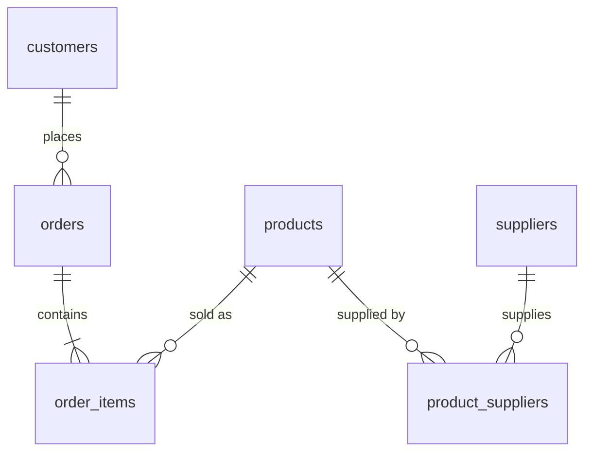

# Customer Orders Data Pipeline

A small ETL pipeline that combines four CSV sources (CRM customers, shop orders,
products, suppliers) into a normalized PostgreSQL schema, validates the load, and
produces business reports. Runs locally with Docker.

## Pipeline

```
crm_customers.csv ─┐
shop_orders.csv ───┤
shop_products.csv ─┼─> staging (raw TEXT) ─> clean + transform ─> final tables ─> validate ─> reports
suppliers.csv ─────┘
```

Cleaning rules: emails are `lower(trim())`, SKUs are `upper(trim())`, and text
values are cast to `DATE` / `NUMERIC` / `INT`. The join keys between sources are the
cleaned **email** and the cleaned **SKU**.

## Schema



Each fact is stored once (3NF). Prices are kept on `order_items` so history stays
accurate when list prices change.

## How to run

Requirements: Docker Desktop, PowerShell.

```powershell
copy .env.example .env      # then set a password
docker compose up -d
.\run_all.ps1
```

## Scripts

| File | Purpose |
|------|---------|
| `sql/01_staging.sql` | Load raw CSVs into TEXT staging tables |
| `sql/02_schema.sql` | Final tables with PK, FK and constraints |
| `sql/03_transform.sql` | Clean and load (idempotent) |
| `sql/04_validate.sql` | Source vs loaded checks (PASS/FAIL) |
| `sql/05_reports.sql` | Revenue per city, profit per product, top customers |

## Sample results

Revenue per city: Kathmandu 4100.00, Unknown 900.00, Pokhara 250.00.
Most profitable product: Mouse (900.00 total profit).

## What I learned

Staging before transforming, normalization, field mapping, and validating row
counts to catch silent data loss from failed joins.